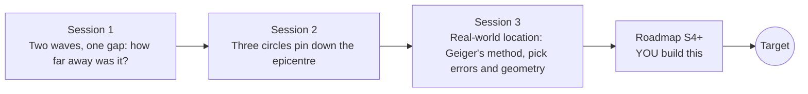

# openseismo

[](https://github.com/KrunalPanchal1995/openseismo/actions/workflows/ci.yml)   [](https://colab.research.google.com/github/KrunalPanchal1995/openseismo/blob/main/sessions/session-01/lesson.ipynb) [](https://krunalpanchal1995.github.io/openseismo/)

**Locate an earthquake from seismograph arrivals, in three sessions.**

openseismo teaches how P and S wave arrival times pin down an earthquake epicentre, from the lightning-and-thunder rule to least-squares location with error ellipses, using only Python and a browser.

- **Start from thunder.** Session 1 needs only division: distance = speed x time, and a gap between two waves.
- **See it move.** Every session ships a slider app that runs in the browser, with labelled graphs.
- **Know you got it right.** Each session ends with a checkpoint that prints PASS or FAIL against hand calculations.
- **Build the missing half.** The repo stops at Session 3 on purpose; the roadmap shows the path to the Target.

[Target](#the-target) · [Who is this for](#who-is-this-for) · [Quick start](#quick-start) · [Sessions](#sessions) · [Roadmap](#roadmap) · [Contribute](#contribute) · [Explainer PDF](docs/explainer.pdf)

> **This repo is incomplete on purpose.** Sessions 1 to 3 are here and fully working. The finished Target below is a preview of what the community can build next. We show you the path, not the code. Sessions 4 and up are yours.

## The Target

A map with five stations. An earthquake starts: a green P wavefront and a slower red S wavefront expand across the map, and a seismogram appears at each station as the waves arrive, with the P pick marked. Then the least-squares iteration starts from a rough guess and walks to the epicentre while the 95 percent error ellipse shrinks around it. Your goal over the coming sessions: build that animation yourself, from picks to ellipse. (All data are synthetic. This is a teaching model, not a warning system.)


*Target: P and S wavefronts, seismograms at five stations, and the least-squares location walking to the epicentre with a shrinking error ellipse*


*Record section: seismograms ordered by distance; the P-S gap widens with distance*


*Same pick errors, two networks: a surrounding network gives a small ellipse, a one-sided network a long thin one*

Try it live:

- [Math Visual Studio: root finding, the engine inside the location step (Atlas S29)](https://krunalpanchal1995.github.io/studio/#atlas?ch=S29&ex=1)
- [Math Visual Studio playground](https://krunalpanchal1995.github.io/studio/)

How the Target was made is shown only as a path in [promo/roadmap.md](promo/roadmap.md).

## Who is this for
**secondary school to diploma / undergraduate (levels 3-5).** Topic area: Geography, Climate, Environment and Earth Science.

Prerequisites:

- Speed = distance / time, and the equation of a circle (school maths).
- Python 3.10 or newer; if `python --version` works, you are ready. PRIMER.md explains the rest.
- No prior GitHub, seismology or linear algebra experience is needed. Educational only: this is not a warning or prediction tool.

New to Python? Read [PRIMER.md](PRIMER.md) first (10 minutes).

## Quick start

No installation knowledge needed. You need [Git](https://git-scm.com/downloads) and [Python 3.10+](https://www.python.org/downloads/) (Windows: tick "Add Python to PATH"). On Mac and Linux type `python3` wherever this page says `python`.

```bash
git clone https://github.com/KrunalPanchal1995/openseismo.git
cd openseismo
python start.py 1
```

`start.py` creates a private environment, installs what is needed and runs Session 1 with its checkpoint. Next: `python start.py 2`, `python start.py 3`, or `python start.py test` to check everything. Only a checkpoint: `python start.py check 1`.

Four lines turn the idea of Session 1 into a result (they work as they are): Save it as `try.py` and run it with `python start.py run try.py` (this uses the private environment, where NumPy is installed):

```python
import numpy as np
gap = 100 / 3.5 - 100 / 6.0                    # S arrives this many seconds after P at 100 km
distance = gap * 6.0 * 3.5 / (6.0 - 3.5)       # turn the gap back into a distance
print(round(gap, 1), 's of gap ->', round(distance, 1), 'km')   # -> 11.9 s of gap -> 100.0 km
```

Every session also opens in your browser with sliders (no install): [live apps](https://krunalpanchal1995.github.io/openseismo/). Or use the Colab badge above for the notebook.

## Sessions

| # | Session | Model level | Time | Live app |
|---|---|---|---|---|
| 1 | [Two waves, one gap: how far away was it?](sessions/session-01/README.md) | Level 1: conceptual interactive model | 60 min | [open](https://krunalpanchal1995.github.io/openseismo/session-01/) |
| 2 | [Three circles pin down the epicentre](sessions/session-02/README.md) | Level 2: mathematical engineering model | 75 min | [open](https://krunalpanchal1995.github.io/openseismo/session-02/) |
| 3 | [Real-world location: Geiger's method, pick errors and geometry](sessions/session-03/README.md) | Level 3: simulation and validation | 90 min | [open](https://krunalpanchal1995.github.io/openseismo/session-03/) |

Each session follows the same six steps: A real-world problem, B concept and theory, C visual explanation, D interactive simulation, E worked example and experiment, F assessment and design challenge. Each ends with `checkpoint.py`, which prints `PASS` or `FAIL` against reference numbers. Session 3 also contains the real-world mini-project: **Locate a synthetic quake from five noisy stations**.

## Architecture



| Folder or file | What is inside |
|---|---|
| `sessions/` | three sessions: README (A-F), `lesson.py`, notebook, live app, exercises, activity sheet, checkpoint |
| `promo/` | the Target: media, live links, and the roadmap (path only) |
| `docs/` | `explainer.tex` and the built `explainer.pdf` |
| `tests/` | runs every lesson and checkpoint headless |
| `start.py` | one command to set up and run anything |
| `QUALITY.md`, `RUBRIC.md` | the quality checklist and the scoring rubric |
| `.github/` | CI, PDF build, Pages deploy, issue and PR templates |

## Roadmap

| Milestone | What you will build | Difficulty |
|---|---|---|
| Session 4: Survive a bad pick | A location routine that spots and drops (or down-weights) a blunder in one pick. | intermediate |
| Session 5: Fix the network | A tool that suggests where to put one more station. | intermediate |
| Session 6: Use the layers | A locator that predicts first arrivals with the two-layer model instead of one speed. | advanced |
| Session 7: Add depth | A four-unknown locator (x, y, depth, t0) with a vertical error bar. | advanced |
| Session 8: Reproduce the Target animation | A GIF of expanding P and S wavefronts, per-station seismograms with picks and the iteration path. | advanced |

Full detail with a checkpoint per milestone: [promo/roadmap.md](promo/roadmap.md).

## Contribute
New to GitHub? Read [CONTRIBUTING.md](CONTRIBUTING.md); it starts from zero. Pick an issue labelled `good first issue`. Translations into Hindi, Telugu, Tamil and Malayalam are welcome.

<details>
<summary>Development</summary>

```bash
python start.py test        # runs every lesson and checkpoint
```
Lessons use `# %%` cell markers so they open as notebooks in VS Code. See [QUALITY.md](QUALITY.md) for the standard every session meets.
</details>

## License
MIT. See [LICENSE](LICENSE). Media in `promo/media` is (c) Krunal Panchal, CC BY 4.0.

## Acknowledgments
Part of the [PAN IIT OSS](https://hellofoss.tech-iitb.org/projects) open-source teaching collection, modelled on the structure of [openspline](https://github.com/openspline/openspline). Built on ideas from the Math Visual Studio at https://krunalpanchal1995.github.io/studio/.
