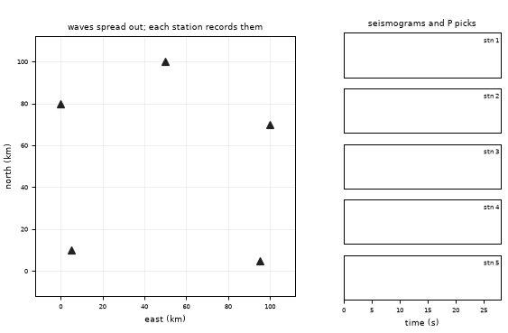
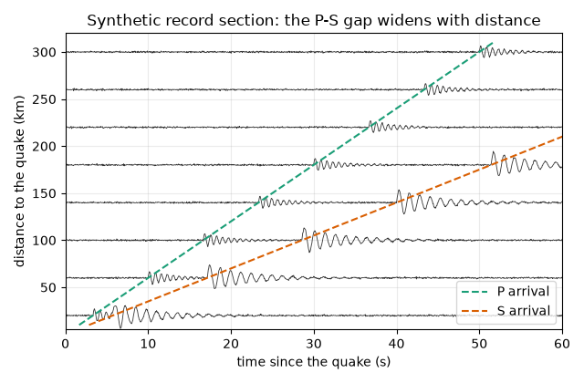
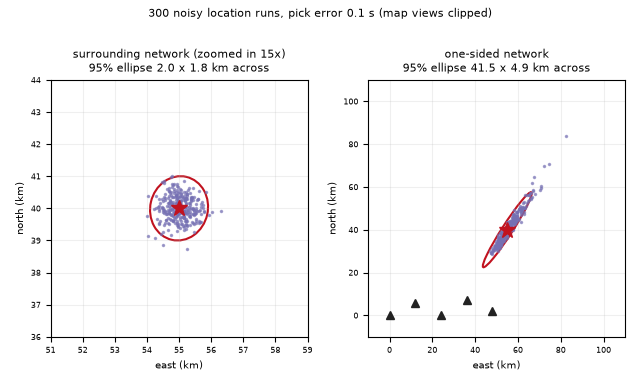

# What you are building toward

A map with five stations. An earthquake starts: a green P wavefront and a slower red S wavefront expand across the map, and a seismogram appears at each station as the waves arrive, with the P pick marked. Then the least-squares iteration starts from a rough guess and walks to the epicentre while the 95 percent error ellipse shrinks around it. Your goal over the coming sessions: build that animation yourself, from picks to ellipse. (All data are synthetic. This is a teaching model, not a warning system.)

*Target: P and S wavefronts, seismograms at five stations, and the least-squares location walking to the epicentre with a shrinking error ellipse*

*Record section: seismograms ordered by distance; the P-S gap widens with distance*

*Same pick errors, two networks: a surrounding network gives a small ellipse, a one-sided network a long thin one*

These results come from a private reference build. The code is not published; the roadmap shows the path so you can build your own.

Live links:

- [Math Visual Studio: root finding, the engine inside the location step (Atlas S29)](https://krunalpanchal1995.github.io/studio/#atlas?ch=S29&ex=1)
- [Math Visual Studio playground](https://krunalpanchal1995.github.io/studio/)
