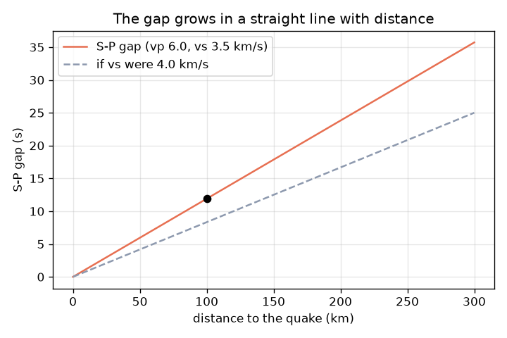
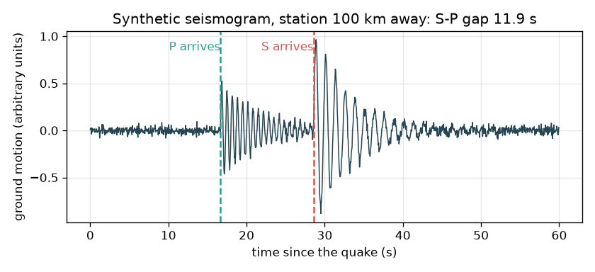

# Session 1: Two waves, one gap: how far away was it?

*Level 1 (conceptual interactive model) · about 60 minutes · openseismo*

> This is a simplified educational model. It is not a validated design tool and must not be used for real structures, electrical installations, vehicles, industrial processes or medical decisions.

**Prerequisites**

- Speed = distance / time (school maths).
- You have read PRIMER.md and run `python start.py 1` once.

**Learning objectives.** After this session you can:

- Explain the difference between a P wave and an S wave and why P arrives first.
- Compute travel times with t = d / v.
- Turn an S-P gap into a distance with the rule 1 second of gap = 8.4 km.
- Read a graph of S-P gap against distance.

## A. Real-world problem
During a storm you see lightning and count the seconds until the thunder: the longer the wait, the farther away the strike. An earthquake works the same way, but both signals are waves in the ground. The first to arrive is the P wave (fast, a push-pull squeeze along the direction of travel); later comes the S wave (slower, a side-to-side shake). A seismograph records both. Can the wait between them tell you how far away the earthquake was? This repo is for learning only: it cannot warn anyone, and earthquakes cannot be predicted.

## B. Concept and theory
A wave covering a distance d at speed v needs the time t = d / v. In typical upper crust we use vp = 6.0 km/s for P waves and vs = 3.5 km/s for S waves (approximate teaching values; real rock varies from place to place). Both start together at the quake, so the S wave falls behind: after distance d the gap is gap = d / vs - d / vp. Turning this around gives d = gap x vp x vs / (vp - vs). With our speeds each second of gap is worth 6.0 x 3.5 / 2.5 = 8.4 km. The lightning rule is the same idea with light (instant) in place of P and sound (about 343 m/s, so 2.9 s per kilometre) in place of S.

| Symbol | Meaning | Unit |
|---|---|---|
| d | distance from the quake to the station | km |
| vp | P wave speed (approximate typical value 6.0) | km/s |
| vs | S wave speed (approximate typical value 3.5) | km/s |
| tp, ts | arrival time of P and S, measured from the start of the quake | s |
| gap | S-P gap = ts - tp | s |

**Assumptions**

- Straight-line travel at constant speed (a simplification; real waves bend and speeds change with depth).
- The quake is a point and starts at one instant.
- The speeds are approximate typical values, not measurements for any real place.
- Educational model only; not for warning or prediction.

$$ t=\frac{d}{v} $$

$$ \text{gap}=t_s-t_p=\frac{d}{v_s}-\frac{d}{v_p} $$

$$ d=\text{gap}\cdot\frac{v_p v_s}{v_p-v_s}\qquad \frac{v_p v_s}{v_p-v_s}=8.4\ \text{km/s} $$

## C. Visual explanation
The first figure is a made-up seismogram for a station 100 km away: quiet, then a small wiggle when P arrives at 16.7 s, then a bigger wiggle when S arrives at 28.6 s, a gap of 11.9 s. The second figure plots the S-P gap against distance: a straight line through zero, reaching 35.7 s at 300 km. A dashed line shows that a faster S wave (4.0 km/s) would give a smaller gap.

*The S-P gap grows in a straight line with distance (35.7 s at 300 km).*

*A made-up seismogram 100 km from the quake: P at 16.7 s, S at 28.6 s, gap 11.9 s.*

## D. Interactive simulation
Run the lesson (`python start.py 1`), then open the live app: [Session 1: P and S waves, and the gap](https://krunalpanchal1995.github.io/openseismo/session-01/) (or `app.html` in this folder). Slide the distance and watch the P and S arrivals separate on the seismogram. Change vs and vp and see how the 'km per second of gap' rule changes.

**Challenge.** Make the S-P gap 20 seconds (within half a second).

## E. Worked example and experiment
**Problem.** A station is 100 km from a quake. Find the P and S arrival times and the gap, then recover the distance from the gap.

1. P wave: tp = 100 / 6.0 = 16.7 s.
2. S wave: ts = 100 / 3.5 = 28.6 s.
3. Gap = 28.6 - 16.7 = 11.9 s (11.905 before rounding).
4. Rule: 1 s of gap = 6.0 x 3.5 / (6.0 - 3.5) = 8.4 km.
5. Distance = 11.905 x 8.4 = 100 km. The round trip agrees.

**Answer.** P at 16.7 s, S at 28.6 s, gap 11.9 s, which gives back 100 km.

**Experiment.** Next thunderstorm, count the seconds from flash to bang. Sound needs about 2.9 s per kilometre (343 m/s), so a count of 9 s means roughly 3 km. Compare with a weather app if you can. The model is exact for a straight path at constant speed; real air and real rock are not uniform, so expect errors of 10 percent or more. For earthquakes, the same idea works with real seismograms downloaded from a public agency: read the P and S times by eye and apply the rule.

## F. Assessment and design challenge
**Question type A: Conceptual.** Why does the P wave always arrive before the S wave? What would the seismogram look like if the quake were very close to the station?

Hint

Which wave has the higher speed? What happens to the gap as the distance gets smaller?

Step-by-step solution

P is faster (6.0 against 3.5 km/s in our model), so over any distance it needs less time. The gap is proportional to distance, so for a very close quake the gap is tiny and the P and S wiggles run into each other; the two arrivals are hard to separate by eye.

**Question type B: Numerical.** A station reads an S-P gap of 15 s. How far away was the quake? Check that the answer is reasonable.

Hint

Use 1 s of gap = 8.4 km.

Step-by-step solution

Distance = 15 x 8.4 = 126 km. Check: P needs 126 / 6.0 = 21.0 s and S needs 126 / 3.5 = 36.0 s, a gap of 15.0 s. The result is in kilometres and is a sensible regional distance.

**Question type C: Graph and simulation interpretation.** On the gap-versus-distance graph, what is the gap at 300 km? What does the slope of the line mean? What changes if the S speed rises to 4.0 km/s?

Hint

Slope = gap / distance = 1/vs - 1/vp.

Step-by-step solution

At 300 km the gap is 35.7 s. The slope, 1/3.5 - 1/6.0 = 0.119 s per km, is the extra delay of S per kilometre travelled (equivalently 1 s per 8.4 km). A faster S wave makes the line flatter: at 100 km the gap would be 8.33 s instead of 11.9 s, so the same measured gap would mean a larger distance.

**Question type D: Design and optimisation challenge.** Design: a seismograph clock can be wrong by up to 0.5 s in the S-P gap you read. How much distance error does that cause, and is it acceptable for a regional map where you want to be within 10 km?

Hint

Multiply the timing error by km per second of gap.

Step-by-step solution

0.5 s x 8.4 km/s = 4.2 km. That is inside a 10 km budget, but a single station still gives only a distance (a circle), not a position, and the speeds themselves are uncertain by several percent, so the real error is larger. Trade-off: a faster sampling rate and careful picking cut the timing error; a second and third station are needed for direction (Session 2).

Score yourself with [RUBRIC.md](../../RUBRIC.md). Print the [activity sheet](activity_sheet.md) to work on paper.

## Common misconceptions
| Common misconception | What is actually true |
|---|---|
| The S wave is the bigger, so it must be faster. | S waves usually carry larger shaking but are the slower wave: about 3.5 km/s against 6.0 km/s for P in our model. |
| The gap tells you the direction to the quake. | The gap gives only a distance. The quake could be anywhere on a circle of that radius around the station. |
| The P wave arrives at the time the quake starts. | Both waves leave the source at the same instant; each needs d / v seconds to arrive. We rarely know the start time, which is why we use the gap. |
| A warning system or this repo can predict an earthquake. | Earthquakes cannot be predicted. This repo only locates a quake after it has happened, using recorded waves. |

## Glossary
- **P wave**: the faster wave, a push-pull compression along the direction of travel
- **S wave**: the slower wave, a side-to-side shear shaking
- **seismograph**: an instrument that records ground motion against time
- **epicentre**: the point on the ground above where the quake started
- **S-P gap**: the time between the S arrival and the P arrival at one station

## Finish
1. Do the three coding tasks in [exercises.md](exercises.md).
2. Run `python start.py 1` again after your changes. It ends with the checkpoint; when it prints `PASS`, you are done. (Checkpoint only: `python start.py check 1`.)

Next: [Session 2](../session-02/README.md)
