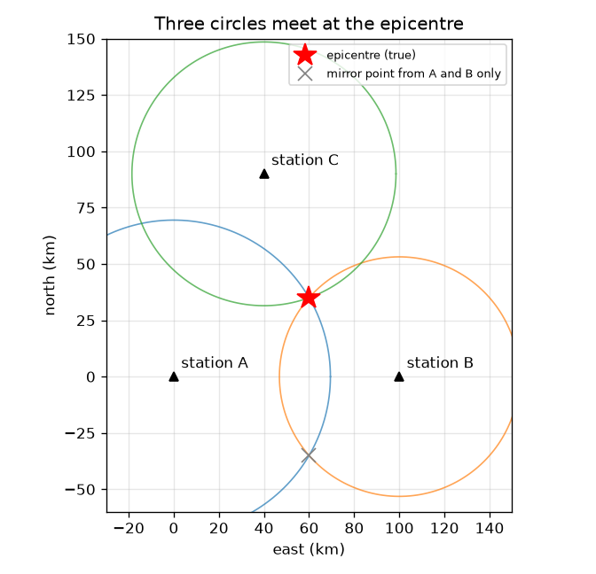
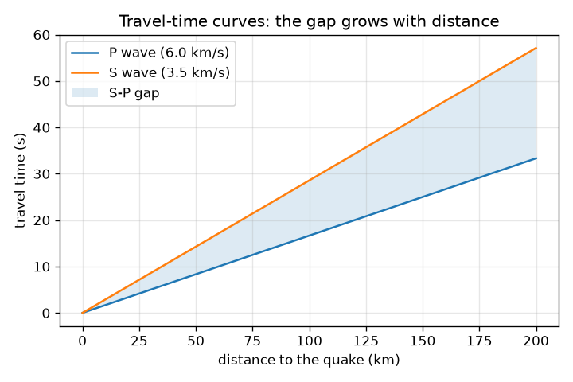

# Session 2: Three circles pin down the epicentre

*Level 2 (mathematical engineering model) · about 75 minutes · openseismo*

> This is a simplified educational model. It is not a validated design tool and must not be used for real structures, electrical installations, vehicles, industrial processes or medical decisions.

**Prerequisites**

- Session 1: the S-P gap and distance.
- The equation of a circle (x - a)^2 + (y - b)^2 = r^2; solving two linear equations.

**Learning objectives.** After this session you can:

- Explain where vp/vs = sqrt(3) comes from for a Poisson's ratio of 0.25.
- Compute distance from the S-P time, d = (ts - tp) vp vs / (vp - vs).
- Find an epicentre from three stations by solving a linear system.
- Explain why two stations are not enough and why three stations on one line fail.

## A. Real-world problem
One station tells you only how far away a quake was, not where. Seismologists use several stations. Three stations at known positions each give a distance; where the three circles meet is the epicentre. How many stations do you really need, how do you compute the meeting point, and how badly does a timing error move it? (Opengps uses the same circle idea with satellites; this session is the earthquake version. Openemwave and openoscillator cover waves in general.)

## B. Concept and theory
In an ideal uniform elastic solid the wave speeds depend on how the material resists compression and shear. Their ratio depends only on Poisson's ratio nu: vp / vs = sqrt(2 (1 - nu) / (1 - 2 nu)). For nu = 0.25 this is sqrt(3) = 1.732; our approximate 6.0 / 3.5 = 1.714 corresponds to nu = 0.242, so the numbers are consistent, though real rock only roughly follows an ideal solid. At each station the origin time cancels in the S-P gap, so d = (ts - tp) vp vs / (vp - vs). A station i at (xi, yi) with distance ri puts the epicentre on a circle (x - xi)^2 + (y - yi)^2 = ri^2. Subtracting the first station's circle from the others removes x^2 + y^2 and leaves straight lines, 2 (xi - x1) x + 2 (yi - y1) y = r1^2 - ri^2 + xi^2 + yi^2 - x1^2 - y1^2, which are solved for (x, y). Two circles meet in two points (a point and its mirror image across the line joining the stations); the third station picks the right one. If the three stations lie on one line, the lines are parallel and no unique answer exists.

| Symbol | Meaning | Unit |
|---|---|---|
| nu | Poisson's ratio of the rock | no unit |
| (xi, yi) | position of station i on a flat map | km |
| ri | distance from station i to the epicentre | km |
| (x, y) | unknown epicentre position | km |
| ts, tp | S and P arrival times | s |

**Assumptions**

- Flat map, straight rays and one constant pair of speeds (6.0 and 3.5 km/s, approximate).
- The quake is at the surface (depth ignored); S and P picks are exact unless stated.
- Station positions are known exactly.
- Educational model only; not for warning or prediction.

$$ \frac{v_p}{v_s}=\sqrt{\frac{2(1-\nu)}{1-2\nu}}\;\xrightarrow{\nu=0.25}\;\sqrt3 $$

$$ d=(t_s-t_p)\frac{v_p v_s}{v_p-v_s} $$

$$ (x-x_i)^2+(y-y_i)^2=r_i^2 $$

$$ 2(x_i-x_1)\,x+2(y_i-y_1)\,y=r_1^2-r_i^2+x_i^2+y_i^2-x_1^2-y_1^2 $$

## C. Visual explanation
The first figure shows three stations A (0, 0), B (100, 0), C (40, 90) km and a made-up quake at (60, 35) km. The three circles pass through one point. Circles A and B alone also meet at the mirror point (60, -35) km, marked with a grey cross; circle C rejects it. The second figure shows the P and S travel-time lines; the shaded gap between them is what you read on a seismogram.

*Three circles meet at the epicentre (60, 35) km; A and B alone also meet at the mirror point.*

*Travel-time lines for P and S: the gap grows with distance.*

## D. Interactive simulation
Run the lesson (`python start.py 2`), then open the live app: [Session 2: three circles and the epicentre](https://krunalpanchal1995.github.io/openseismo/session-02/) (or `app.html` in this folder). Move the quake with the two position sliders and watch the three circles and the estimate. Then add a clock error at station A and see how far the estimate moves.

**Challenge.** Station A's S-P gap is read 1.0 s too long. Place the quake so that the estimate is still wrong by less than 3 km.

## E. Worked example and experiment
**Problem.** Stations A (0, 0), B (100, 0), C (40, 90) km record a quake at (60, 35) km. Compute the distances and S-P gaps, then recover the epicentre from the gaps.

1. Distances: rA = sqrt(60^2 + 35^2) = 69.46 km, rB = sqrt(40^2 + 35^2) = 53.15 km, rC = sqrt(20^2 + 55^2) = 58.52 km.
2. Gaps: rA / 8.4 = 8.27 s, rB / 8.4 = 6.33 s, rC / 8.4 = 6.97 s. Going back, 8.27 x 8.4 = 69.5 km.
3. Line from A and B: 200 x = rA^2 - rB^2 + 100^2 = 12000, so x = 60 km.
4. Line from A and C: 80 x + 180 y = rA^2 - rC^2 + 40^2 + 90^2 = 11100. With x = 60: 180 y = 6300, so y = 35 km.
5. The epicentre is (60, 35) km. Check: the mirror point (60, -35) is 126.6 km from C, not 58.5 km.

**Answer.** Epicentre (60, 35) km, recovered exactly from the three S-P gaps (8.27, 6.33 and 6.97 s).

**Experiment.** Draw the map on squared paper (1 cm = 10 km), set a compass to each radius and draw the three circles. On paper they meet in a small triangle, not a point, because your pencil and compass are not exact. Real stations are the same: the S-P times carry reading errors (a 0.5 s error at one station moves the answer by 3.6 km here, and 1.0 s by 7.4 km), so real circles never meet exactly and we need a best-fit method (Session 3).

## F. Assessment and design challenge
**Question type A: Conceptual.** Why do two stations leave two possible epicentres, and why does a third station fix this? Why do three stations on one straight line still fail?

Hint

Draw two circles that overlap. Where does the third circle have to go?

Step-by-step solution

Two circles centred on different points meet in two points that are mirror images across the line joining the centres. A third station not on that line has a circle that passes through only one of the two points, so it picks the right one. If all three stations are on one line, every circle is mirror-symmetric about that line, so the mirror point fits all of them: the answer stays ambiguous (and the linear system has rank 1, so the code rejects it).

**Question type B: Numerical.** Compute the ratio vp/vs for Poisson's ratio 0.25 and compare it with 6.0 / 3.5. Which Poisson's ratio gives exactly 6.0 / 3.5?

Hint

Use vp/vs = sqrt(2 (1 - nu) / (1 - 2 nu)); to invert, square the ratio first: nu = (q - 2) / (2 (q - 1)) with q = (vp/vs)^2.

Step-by-step solution

nu = 0.25 gives sqrt(2 x 0.75 / 0.5) = sqrt(3) = 1.732. And 6.0 / 3.5 = 1.714, a 1 percent difference. For q = 1.714^2 = 2.939 we get nu = 0.939 / (2 x 1.939) = 0.242. Both values are typical of crustal rock.

**Question type C: Graph and simulation interpretation.** In the app, set the quake to (60, 35) km and add a clock error of +1.0 s at station A. Describe how the black dot moves relative to the red cross. Is the error the same everywhere on the map?

Hint

Move the quake to (10, 10) and compare.

Step-by-step solution

The estimate lands 7.4 km away from the true point at (60, 35), because circle A grows by 8.4 km. At (10, 10), close to station A, the same 1.0 s clock error moves the estimate by only 1.9 km. The effect of a timing error depends on where the quake is relative to the network.

**Question type D: Design and optimisation challenge.** Design: you can place a third station at (50, 0), (100, 90) or (40, 90) next to A (0, 0) and B (100, 0). Which choices let you find an epicentre at (60, 35) km, and which fail? What is the minimum number of stations for an epicentre from S-P times, and why?

Hint

A station on the line through A and B adds no new information about north-south position.

Step-by-step solution

(50, 0) is on the line through A and B: the system is rank deficient and the code refuses it. (100, 90) and (40, 90) are both off the line and work; (40, 90) is the choice we used. Three non-collinear stations are the minimum, because two circles leave a mirror ambiguity. A fourth station gives a check and lets you average out errors. Trade-off: more stations cost more, but protect against one bad reading.

Score yourself with [RUBRIC.md](../../RUBRIC.md). Print the [activity sheet](activity_sheet.md) to work on paper.

## Common misconceptions
| Common misconception | What is actually true |
|---|---|
| Two stations are enough to locate a quake. | Two circles meet in two points. A third, non-collinear station is needed to choose between them. |
| The circles meet at exactly one point in real data. | Reading errors make real circles meet in a small region; the exact meeting point exists only for perfect data. |
| vp/vs is a universal constant equal to sqrt(3). | sqrt(3) holds for a Poisson's ratio of 0.25 in an ideal elastic solid; real rock varies, and we treat 6.0 / 3.5 as approximate. |
| A timing error moves the epicentre the same amount everywhere. | The size of the shift depends on the geometry of the stations and the quake. |

## Glossary
- **Poisson's ratio**: how much a material narrows sideways when stretched; 0.25 is typical for rock
- **trilateration**: finding a position from distances to known points
- **collinear**: lying on one straight line
- **mirror point**: the second place two circles meet, the reflection of the true point
- **travel-time curve**: arrival time plotted against distance

## Finish
1. Do the three coding tasks in [exercises.md](exercises.md).
2. Run `python start.py 2` again after your changes. It ends with the checkpoint; when it prints `PASS`, you are done. (Checkpoint only: `python start.py check 2`.)

Next: [Session 3](../session-03/README.md)
