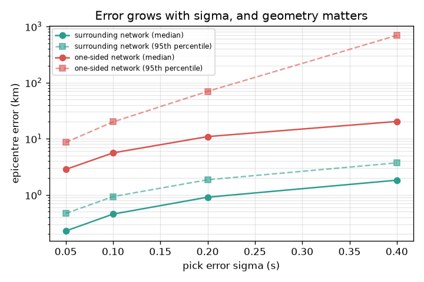
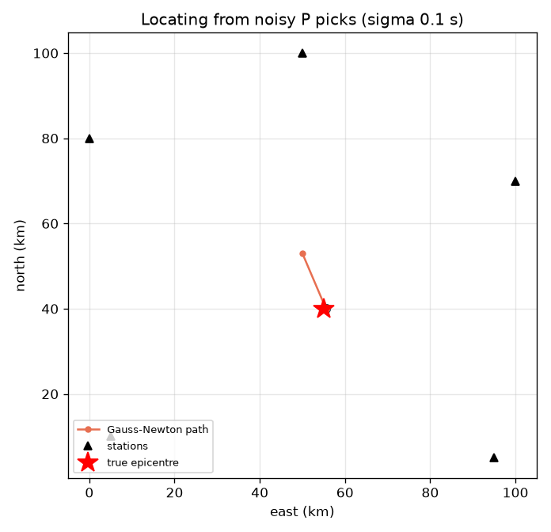
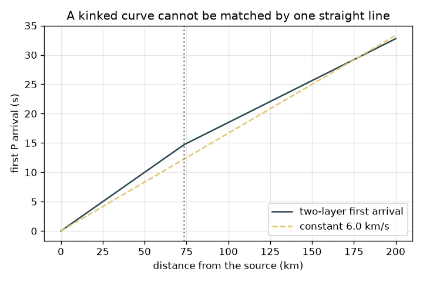

# Session 3: Real-world location: Geiger's method, pick errors and geometry

*Level 3 (simulation and validation) · about 90 minutes · openseismo*

> This is a simplified educational model. It is not a validated design tool and must not be used for real structures, electrical installations, vehicles, industrial processes or medical decisions.

**Prerequisites**

- Session 1 and 2.
- Matrices as tables of numbers; the idea of a least-squares fit; basic statistics (mean, standard deviation).

**Learning objectives.** After this session you can:

- Locate (x, y, t0) from P arrival times at N >= 4 stations with Geiger's Gauss-Newton method.
- Measure how pick noise and station geometry change the epicentre error (Monte Carlo, condition number).
- Draw and test a 95 percent error ellipse from the covariance.
- Explain why a constant-speed assumption biases the answer when the real speed rises with depth, and estimate a simple magnitude.

## A. Real-world problem
In real life nobody tells you when the quake started, and arrival times are picked by eye or by software with errors of a fraction of a second. So you have three unknowns (east x, north y and origin time t0) and several noisy P arrival times. How do you find the best epicentre, how wrong can it be, which networks are good, and what happens if the speed model is wrong? Remember: this only locates a quake after it happened; it is not a warning or prediction tool, and earthquakes cannot be predicted.

## B. Concept and theory
At station i the P wave arrives at ti = t0 + Ri / vp with Ri = sqrt((xi - x)^2 + (yi - y)^2). The unknowns (x, y, t0) enter non-linearly, so Geiger's method guesses, linearises and repeats: with residual ri = observed - predicted, a small change dm = (dx, dy, dt0) changes ti by Ji . dm where Ji = (-(xi - x)/(vp Ri), -(yi - y)/(vp Ri), 1). Solve J dm = r in the least-squares sense, add dm to the guess, and iterate (Gauss-Newton). If picks have independent Gaussian errors of standard deviation sigma, the solution has covariance C = sigma^2 (J^T J)^-1; its (x, y) block gives the 95 percent error ellipse with semi-axes sqrt(5.991 lambda), where lambda are the eigenvalues and 5.991 is the 95 percent point of the chi-square distribution with 2 degrees of freedom. Two numbers summarise geometry: the condition number of J (large means nearly degenerate) and the horizontal dilution sqrt(Cxx + Cyy)/sigma in km per second of pick error. The failure case is a two-layer Earth (thickness H over a faster half-space, speeds v1 < v2): the first arrival is the direct wave x / v1 or the head wave x / v2 + 2H sqrt(v2^2 - v1^2)/(v1 v2), whichever is earlier, so the travel-time curve has a kink and no single constant speed fits. For magnitude we use the approximate educational formula ML = log10 A + 3 log10(8 dt) - 2.92, where A is the peak amplitude in mm on a Wood-Anderson seismograph and dt the S-P time in seconds (a textbook form; agencies use calibrated scales).

| Symbol | Meaning | Unit |
|---|---|---|
| (x, y) | unknown epicentre | km |
| t0 | unknown origin time | s |
| ti | observed P arrival at station i | s |
| sigma | standard deviation of a pick error | s |
| J | Jacobian: change of arrival time per change of (x, y, t0) | s/km, s/km, no unit |
| C | covariance of the solution | km^2, km^2 (and s^2) |
| H, v1, v2 | layer thickness and speeds of the toy Earth (15 km, 5.0 and 7.0 km/s) | km, km/s |
| A, dt, ML | amplitude in mm, S-P time in s, magnitude | mm, s, no unit |

**Assumptions**

- Flat map, surface source, constant vp = 6.0 km/s (approximate) except in the two-layer toy.
- Pick errors are independent, Gaussian and the same size at every station.
- Linearised error theory (J at the solution) and 2-D horizontal error only; depth is ignored.
- All data are synthetic; the magnitude formula is approximate; not a warning or prediction tool.

$$ t_i=t_0+\frac{R_i}{v_p},\quad R_i=\sqrt{(x_i-x)^2+(y_i-y)^2} $$

$$ J_i=\left(-\frac{x_i-x}{v_pR_i},\,-\frac{y_i-y}{v_pR_i},\,1\right),\qquad J\,\delta m=r\;\Rightarrow\;\delta m=(J^{\mathsf T}J)^{-1}J^{\mathsf T}r $$

$$ C=\sigma^2\,(J^{\mathsf T}J)^{-1},\qquad a_{95},\,b_{95}=\sqrt{5.991\,\lambda_{1,2}} $$

$$ t_{\text{head}}=\frac{x}{v_2}+\frac{2H\sqrt{v_2^2-v_1^2}}{v_1v_2} $$

$$ M_L=\log_{10}A+3\log_{10}(8\,\Delta t)-2.92 $$

## C. Visual explanation
The first figure is a map: five surrounding stations, the true epicentre (55, 40) km, the Gauss-Newton path (a rough start 13.9 km away reaches the epicentre in a few steps) and the 95 percent ellipse. The second figure shows the median and 95th-percentile epicentre error against pick noise sigma on a log scale, for a surrounding network and a one-sided network: both lines rise in proportion to sigma, but the one-sided network is more than ten times worse. The third figure shows the two-layer first-arrival curve with its kink at 73.5 km against the straight constant-speed line.

*Epicentre error against pick noise: proportional to sigma, and strongly dependent on station geometry.*

*Geiger's iteration from the station centroid to the epicentre, with the 95 percent error ellipse.*

*A two-layer Earth gives a kinked first-arrival curve that one constant speed cannot match.*

## D. Interactive simulation
Run the lesson (`python start.py 3`), then open the live app: [Session 3: locate from noisy P picks](https://krunalpanchal1995.github.io/openseismo/session-03/) (or `app.html` in this folder). Change the pick error sigma, the network shape (0 = stations surround the quake, 1 = all in one corner, as in the lesson) and the random seed (a different draw of noise). Watch the path, the error and the ellipse; open the second view to see the ellipse grow in proportion to sigma.

**Challenge.** Make the 95 percent ellipse semi-major axis smaller than 1.5 km with a pick error of at least 0.1 s.

## E. Worked example and experiment
**Problem.** For the surrounding network, quake (55, 40) km, vp = 6.0 km/s: compute the Jacobian row of station (5, 10) at the true quake, then describe the first Gauss-Newton step from the station centroid (50, 53).

1. Distance R = sqrt(50^2 + 30^2) = 58.31 km.
2. Jx = -(5 - 55) / (6.0 x 58.31) = 50 / 349.9 = 0.143 s/km.
3. Jy = -(10 - 40) / (6.0 x 58.31) = 30 / 349.9 = 0.086 s/km, and Jt0 = 1.
4. The start (50, 53) is sqrt(5^2 + 13^2) = 13.9 km from the truth.
5. One step with all five rows reduces that to 0.21 km, and the next step to essentially zero (noise-free picks).

**Answer.** Jacobian row (0.143, 0.086, 1); the iteration starts 13.9 km away and is within 0.21 km after one step.

**Experiment.** Download P arrival times for a real moderate quake from a public seismic network, locate it with `geiger` using a single speed, and compare with the agency's catalogue location. Expect a difference of kilometres to tens of kilometres. Model versus reality: real crust has layers (see the two-layer toy, 1.32 km off for a surrounding network and 19.0 km for a one-sided one), real picks have errors, and the real source has a depth that this 2-D model ignores.

## Real-world application and mini-project: Locate a synthetic quake from five noisy stations
A synthetic earthquake (true epicentre (55, 40) km, origin time 3 s) is recorded by the five surrounding stations of Session 3, at vp = 6.0 km/s. Add Gaussian noise of 0.1 s to the P picks (random seed 3), locate the quake with `geiger`, report the epicentre error in km, and draw the 95 percent error ellipse from the covariance. Then repeat with the one-sided network and compare.

**Deliverable:** A script that prints the epicentre, its error in km and the ellipse semi-axes and angle, and saves a map picture with the stations, the true epicentre, the Gauss-Newton path and the ellipse. A second picture or printout does the same for the one-sided network.

**Success looks like:** With seed 3 and the surrounding network the error is 0.67 km and the ellipse is 1.01 x 0.90 km with the true epicentre inside it. Over 1000 random draws the ellipse contains the true epicentre in 93 to 97 percent of cases. The one-sided network gives a median error of 5.6 km at the same pick noise.

## F. Assessment and design challenge
**Question type A: Conceptual.** Why do stations all on one side of the quake give a much worse epicentre than stations all around it, even with the same pick errors?

Hint

Think about the directions from the quake to the stations, and what the columns of J look like when those directions are nearly equal.

Step-by-step solution

The x and y columns of J are the directions to the stations divided by vp. If the stations all lie in nearly the same direction, those columns become nearly parallel to each other and to the constant t0 column, so J is nearly degenerate (condition number 195 against 9.2) and a small timing change can slide the solution a long way along the line of sight (horizontal dilution 85 km/s against 5.5 km/s). With stations all around, the directions cancel and the solution is stiff.

**Question type B: Numerical.** A station with S-P gap 20 s records a peak amplitude of 2 mm. Estimate ML with the approximate formula. Is it plausible? How does ML change for 20 mm?

Hint

ML = log10 A + 3 log10(8 dt) - 2.92.

Step-by-step solution

log10(2) = 0.301; 8 x 20 = 160, log10(160) = 2.204, times 3 = 6.612; ML = 0.301 + 6.612 - 2.92 = 3.99, about 4.0 (approximate). Ten times the amplitude adds exactly 1.0 to ML, so 20 mm gives about 5.0. Sanity check: a magnitude near 4 at about 170 km (20 s x 8.4 km/s = 168 km) with a few mm of motion is plausible.

**Question type C: Graph and simulation interpretation.** In the error-versus-sigma figure, what is the median error of the surrounding network at sigma = 0.2 s, and for the one-sided network? What does a straight line on the log plot tell you?

Hint

Compare 0.2 s with 0.1 s: doubling sigma.

Step-by-step solution

At sigma = 0.2 s the surrounding network has a median error of 0.91 km and the one-sided network 10.9 km, roughly twelve times worse. A rising line means the error grows with sigma: doubling sigma doubles the error (0.45 km at 0.1 s, 0.91 km at 0.2 s), as linear theory says. Geometry sets the proportionality constant. The 95th percentile of the one-sided network is even worse because the iteration can diverge for unlucky noise.

**Question type D: Design and optimisation challenge.** Design: you must report epicentres within about 1.5 km (95 percent) using picks with sigma = 0.1 s. Would the surrounding network meet this? What about the one-sided network, and what is the cheapest fix for it?

Hint

Use the ellipse semi-axes and the dilution numbers.

Step-by-step solution

The surrounding network has a 95 percent ellipse of about 1.0 x 0.9 km, so yes. The one-sided network has a median error of 5.6 km and 95th percentile near 20 km: no. A cheap fix is one extra station on the far side: a station at (100, 90) km cuts the horizontal dilution from 85 km/s to below 12 km/s. The alternative, better picks, costs more effort and helps only in proportion to sigma. Remember also the layered-Earth bias, which no number of stations removes while the speed model is wrong.

Score yourself with [RUBRIC.md](../../RUBRIC.md). Print the [activity sheet](activity_sheet.md) to work on paper.

## Common misconceptions
| Common misconception | What is actually true |
|---|---|
| A small residual means the location is right. | In the two-layer toy the rms residual is only 0.077 s, similar to normal pick noise, yet the epicentre is 1.32 km off. A wrong speed model can hide in the residuals. |
| More stations always fix a bad network. | Stations must surround the quake. Adding stations on the same side adds little; one well-placed far station helps a lot. |
| The 95 percent ellipse is the region where the quake is 95 percent certain to be, whatever the model. | It describes only pick noise within the assumed model. A wrong speed model or an outlier pick shifts the answer outside it. |
| The magnitude formula here is the official one. | It is a simple approximate textbook form; real agencies use calibrated station corrections and several scales. |

## Glossary
- **Geiger's method**: locating a quake by linearising the travel-time equations and iterating least squares
- **Gauss-Newton**: repeated linearise-and-solve steps for a non-linear least-squares problem
- **Monte Carlo**: repeating a calculation many times with random errors to see the scatter
- **condition number**: how strongly a matrix can magnify errors; big means nearly degenerate
- **error ellipse**: an ellipse containing the true position with a stated probability
- **head wave**: a wave that runs along the boundary of a faster layer and returns to the surface

## Finish
1. Do the three coding tasks in [exercises.md](exercises.md).
2. Run `python start.py 3` again after your changes. It ends with the checkpoint; when it prints `PASS`, you are done. (Checkpoint only: `python start.py check 3`.)

Next: the [roadmap](../../promo/roadmap.md). Session 4 is yours to build.
